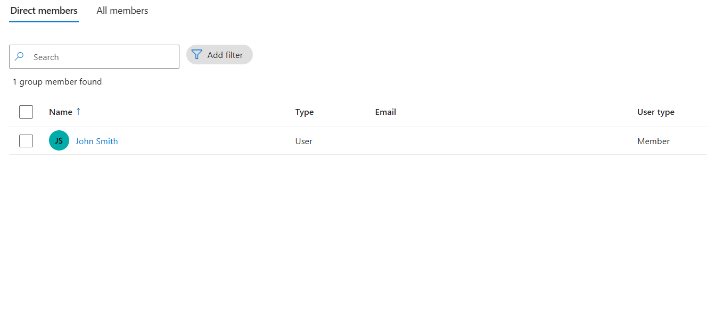

# Microsoft Entra ID User and Group Management Lab

## Goal
Practice basic identity lifecycle and group access management in a test tenant.

## What I did
- Created a sample user and updated profile information.
- Created a security group.
- Added the sample user to the group and managed group ownership.
- Reset the sample user's password.
- Reviewed available sign-in and audit logs.

## What I practiced
User lifecycle management, group-based access, and reviewing identity activity.

## Lab environment
Completed in a personal test tenant using sample data. No production user information or credentials are included.
## Evidence

